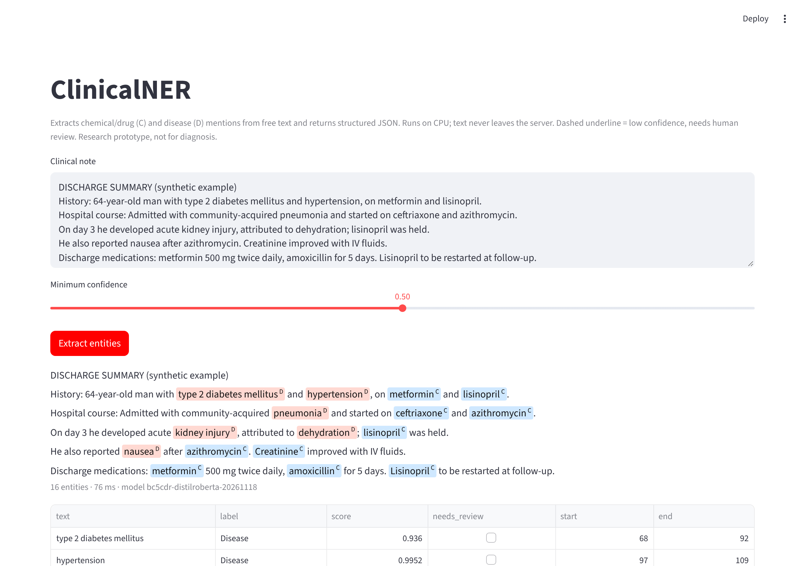
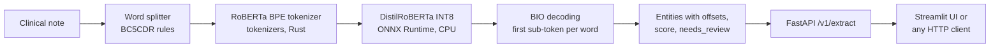

# ClinicalNER

[](https://github.com/quicklearner404/ClinicalNER/actions/workflows/ci.yml)
[](LICENSE)
[](https://huggingface.co/quicklearner404/clinical-ner-bc5cdr-onnx)

**Turns free-text clinical records into structured drug/chemical and disease data, on a plain CPU, without patient text ever leaving the server.**

A fine-tuned DistilRoBERTa model, exported to ONNX and quantised to INT8, served by a FastAPI REST API in a Docker container. Model weights: [quicklearner404/clinical-ner-bc5cdr-onnx](https://huggingface.co/quicklearner404/clinical-ner-bc5cdr-onnx) on the Hugging Face Hub. Send it a note and get back every chemical/drug and disease mention, with its exact character position, a confidence score and a flag for anything a human should double-check.



## Why this exists

Most of what a hospital knows about a patient is written as free text: discharge summaries, progress notes, case reports. Software can't search, count or check text like that, so questions like *"which patients are on warfarin?"* or *"has anyone reported this side effect?"* mean someone has to read the notes.

Sending those notes to a hosted LLM is often not an option. Patient data can't leave the hospital network, many hospitals have no GPUs and no budget for API calls, and LLM output is hard to audit and can change from run to run. ClinicalNER is built around those constraints:

| Constraint | Design choice |
|---|---|
| Patient text must stay on-premises | Self-contained Docker image, no outbound calls at inference time |
| No GPU, small budget | 82 MB INT8 ONNX model, runs on ordinary CPUs; no PyTorch in the image |
| Results must be checkable | Every entity has character offsets into the original text and a confidence score; low-confidence ones are flagged `needs_review` |
| Has to plug into other systems | Versioned REST API with an OpenAPI schema, health and readiness probes |

## Results

**Accuracy**: BC5CDR test set (5,865 sentences), entity-level, exact span and type match:

| | Precision | Recall | F1 |
|---|---|---|---|
| Overall | 0.835 | 0.880 | **0.857** |
| Chemical | | | 0.912 |
| Disease | | | 0.793 |

**Serving**: same test set, 4-core CPU, one request at a time ([`reports/benchmark.json`](reports/benchmark.json)):

| Runtime | Test F1 | Sentence p50 / p95 | Note (~137 words) p50 / p95 | Model size |
|---|---|---|---|---|
| PyTorch fp32 | 0.857 | 20.9 / 33.5 ms | 65.6 / 90.4 ms | 326 MB |
| ONNX Runtime fp32 | 0.857 | 13.5 / 29.9 ms | 54.1 / 73.8 ms | 326 MB |
| **ONNX Runtime INT8** (served) | **0.857** | **5.5 / 11.7 ms** | **31.4 / 52.6 ms** | **82 MB** |

INT8 quantisation keeps accuracy unchanged while cutting median latency 3.8× per sentence and 2.1× per note, and model size 4×. The API image ships without PyTorch.

## How it works



- **Training** (`training/train.py`): `distilroberta-base` fine-tuned for token classification on [BC5CDR](https://huggingface.co/datasets/tner/bc5cdr) (BioCreative V Chemical-Disease Relation corpus) with labels `B/I-Chemical` and `B/I-Disease`. Only the first sub-token of each word carries a label, and evaluation is entity-level with `seqeval`: a prediction counts only if both the span and the type are exactly right.
- **Export** (`training/export_onnx.py`): PyTorch to ONNX (opset 17, dynamic batch and sequence axes), then dynamic INT8 quantisation of the weights with ONNX Runtime.
- **Serving** (`src/clinical_ner/`): the model loads once at startup. Text is split into words the same way BC5CDR was tokenised, long notes are split into chunks that fit the 512-token window, and word predictions are merged into entity spans mapped back to the original characters.

## Quick start (Docker)

```bash
git clone https://github.com/quicklearner404/ClinicalNER.git
cd ClinicalNER
pip install huggingface_hub && python scripts/download_model.py   # ~90 MB, from the Hugging Face Hub
docker compose up --build
```

- API docs: http://localhost:8000/docs
- Demo UI: http://localhost:8501

Once built, the image needs no network access.

## API

```bash
curl -X POST http://localhost:8000/v1/extract \
  -H "Content-Type: application/json" \
  -d '{"text": "Patient developed acute renal failure after starting cisplatin."}'
```

```json
{
  "entities": [
    {"text": "acute renal failure", "label": "Disease", "start": 18, "end": 37, "score": 0.9952, "needs_review": false},
    {"text": "cisplatin", "label": "Chemical", "start": 53, "end": 62, "score": 0.998, "needs_review": false}
  ],
  "model": {"name": "model.int8.onnx", "version": "bc5cdr-distilroberta-20261118"},
  "processing_ms": 10.0
}
```

| Endpoint | Purpose |
|---|---|
| `POST /v1/extract` | Extract entities. Body: `text` (required), `min_score` (optional, 0 to 1) |
| `GET /health` | Liveness: the process is up |
| `GET /ready` | Readiness: the model is loaded (returns 503 with the reason if not) |

Configuration (environment variables): `MODEL_DIR`, `MODEL_FILE` (`model.int8.onnx` or `model.onnx`), `MIN_SCORE` (default 0.5), `REVIEW_THRESHOLD` (default 0.85), `MAX_TEXT_CHARS` (default 20000), `ORT_THREADS`.

## Local development

```bash
python -m venv .venv && source .venv/bin/activate   # Windows: .venv\Scripts\activate
pip install -r requirements-dev.txt
python scripts/download_model.py

uvicorn clinical_ner.api:app --app-dir src --reload   # API on :8000
streamlit run ui/app.py                              # UI on :8501
pytest && ruff check .
```

CI runs three jobs on every push: lint and unit tests; integration tests against the real model downloaded from the Hugging Face Hub (including the API example above, reproduced exactly, and offset checks on a note far longer than the 512-token window); and a Docker build that starts the container and checks it serves a prediction.

### Reproduce the model

```bash
python training/train.py                 # fine-tune on BC5CDR, writes reports/metrics.json
python training/export_onnx.py           # ONNX fp32 and INT8 into models/clinical-ner-onnx
python training/benchmark.py             # accuracy and latency comparison, writes reports/benchmark.json
```

## Project layout

```
src/clinical_ner/    api.py (FastAPI) · model.py (ONNX Runtime) · postprocess.py · schemas.py · config.py
training/            train.py · export_onnx.py · benchmark.py
ui/                  Streamlit demo and its Dockerfile
scripts/             download_model.py · publish_model.py (Hugging Face Hub, with model card)
tests/               API tests with a stub model, post-processing unit tests,
                     real-model integration tests (run when the model is downloaded)
reports/             metrics.json and benchmark.json from the runs above
```

## Limitations

- **Research prototype, not a medical device.** Use it for structuring and searching text with a human in the loop, never for diagnosis or treatment decisions.
- **Trained on PubMed abstracts, not hospital notes.** BC5CDR is the standard public benchmark for chemical and disease mentions, but real notes have abbreviations, typos and section headers it never saw. Accuracy on real records will be lower until it is fine-tuned on in-domain data.
- **Two entity types.** `Chemical` covers drugs as well as other chemicals; there are no dosages, routes, or relations between entities (for example drug to adverse effect).
- **English only.**

Dataset: BioCreative V CDR (Li et al., 2016, *Database*), via `tner/bc5cdr`. Check the original corpus terms before any commercial use.

## License

Code: [MIT](LICENSE). The BC5CDR training data has its own terms (see above).
